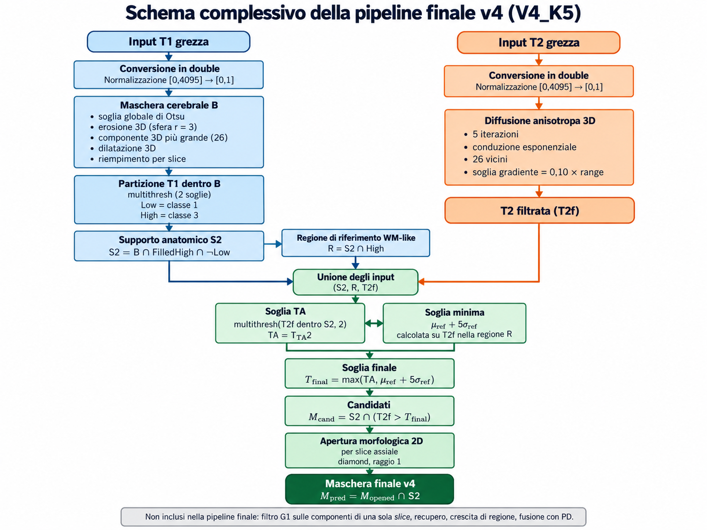

# 3. Metodologia

Questo capitolo descrive la pipeline di segmentazione finale, indicata come **v4** (configurazione **V4_K5**). Si descrive soltanto il metodo nella sua forma definitiva; il percorso sperimentale che ha portato a ciascuna scelta, comprese le alternative valutate e scartate, è ricostruito nel Capitolo 5.

La pipeline è completamente automatica e deterministica: riceve in ingresso i due volumi grezzi T1 e T2 di un caso e restituisce una maschera binaria 3D delle lesioni. Tutte le soglie sono stimate automaticamente dalle intensità del volume in esame; la ground truth non viene mai utilizzata dalla segmentazione.

## 3.1 Architettura generale della pipeline

La pipeline usa le due modalità con ruoli distinti:

- la **T1** serve a delimitare dove le lesioni possono trovarsi: da essa si ricavano la maschera cerebrale e il supporto anatomico S2;
- la **T2** serve a decidere quali voxel, all'interno di quel supporto, sono lesioni: nelle immagini T2 le lesioni di SM appaiono iperintense.

Lo schema complessivo è il seguente:

```text
T1 grezza → conversione e normalizzazione → maschera cerebrale → supporto anatomico S2
T2 grezza → conversione e normalizzazione → diffusione anisotropa 3D → T2 filtrata
T2 filtrata + S2 → livello TA: multithresh della T2 filtrata dentro S2
S2 + regione WM-like → soglia minima μref + 5·σref
livello TA + soglia minima → soglia finale = max(TA, soglia minima)
T2 filtrata + S2 + soglia finale → candidati = S2 ∩ (T2 filtrata > soglia finale)
candidati → apertura morfologica 2D assiale (diamond, raggio 1)
maschera aperta → intersezione con S2
→ maschera finale v4 (M_pred)
```



*Figura 3.1 – Schema a blocchi della pipeline finale v4 (V4_K5).*

Nel resto del capitolo si usano le seguenti notazioni: $T1_n$ e $T2_n$ sono i volumi normalizzati, $T2_f$ è la T2 dopo il filtraggio anisotropo, $B$ è la maschera cerebrale, $S2$ il supporto anatomico e $M_{pred}$ la maschera finale.

## 3.2 Conversione e normalizzazione delle immagini

I volumi BrainWeb sono letti come interi a 16 bit senza segno con valori nell'intervallo 0–4095 (Sezione 2.2). Ogni volume viene innanzitutto convertito nella classe di lavoro `double`; la conversione è verificata come esatta, poiché tutti i valori interi fino a 4095 sono rappresentabili senza errore in doppia precisione.

Il volume convertito viene poi normalizzato con una **trasformazione lineare a intervallo fisso**:

$$ I_n = \frac{I - 0}{4095 - 0}, \qquad [0, 4095] \rightarrow [0, 1] $$

L'intervallo di ingresso è quello nominale del formato BrainWeb e non viene stimato dal singolo volume (ad esempio dal suo minimo e massimo). In questo modo la normalizzazione non dipende dal contenuto dell'immagine e mantiene confrontabili le intensità tra casi diversi e tra livelli di rumore diversi. Un valore fuori dall'intervallo atteso interrompe l'elaborazione con un errore invece di essere tagliato silenziosamente.

## 3.3 Estrazione della maschera cerebrale

La maschera cerebrale $B$ delimita il tessuto cerebrale ed esclude sfondo, cranio e tessuti extracerebrali. È ricavata **dalla sola T1** normalizzata, con la seguente sequenza:

1. **soglia globale di Otsu sulla T1**: una sola soglia è calcolata con il metodo di Otsu [Otsu, 1979] sulla distribuzione di tutti i voxel del volume e applicata identica a ogni slice assiale, producendo una maschera grezza di primo piano;
2. **erosione 3D** della maschera grezza con un elemento strutturante sferico di raggio 3;
3. **selezione della componente connessa 3D più grande**, con connettività 26;
4. **dilatazione** della componente selezionata con la stessa sfera di raggio 3;
5. **limitazione alla maschera grezza iniziale**: la dilatazione viene intersecata con la maschera di Otsu, così che non possa aggiungere voxel che la soglia aveva escluso;
6. **riempimento dei buchi slice per slice**.

La soglia di Otsu separa il segnale dallo sfondo, ma la maschera grezza può contenere anche strutture extracerebrali, come i tessuti dello scalpo, collegate al cervello da sottili ponti di voxel. L'erosione interrompe questi collegamenti, la selezione della componente più grande isola il cervello e la successiva dilatazione, limitata alla maschera grezza, ne restituisce l'estensione senza reintrodurre le strutture staccate. Il riempimento finale chiude le cavità interne alla maschera, ad esempio le regioni scure in T1 completamente circondate da tessuto cerebrale.

La maschera cerebrale non è una segmentazione anatomica di riferimento: è un supporto automatico che limita l'analisi successiva al volume intracranico. Nelle figure 3D della relazione la sua superficie è mostrata soltanto come contesto spaziale.

## 3.4 Costruzione del supporto anatomico S2

Il supporto S2 restringe ulteriormente la regione in cui una lesione può essere cercata. Nasce dall'osservazione, discussa nel Capitolo 5, che all'interno della maschera cerebrale gran parte dei falsi positivi della T2 è costituita da strutture iperintense diverse dalle lesioni, in particolare il liquor, che in T2 è brillante quanto o più delle lesioni.

La costruzione usa di nuovo la sola T1 normalizzata, nella quale il liquor è scuro e la sostanza bianca è chiara.

**Partizione della T1.** Sui soli voxel della maschera cerebrale si calcolano con `multithresh` due soglie (metodo di Otsu multi-livello), che dividono le intensità T1 in tre classi:

- **Low** = classe 1, le intensità T1 più basse, che comprendono il liquor;
- classe 2, le intensità intermedie;
- **High** = classe 3, le intensità T1 più alte, compatibili con la sostanza bianca.

**Riempimento della classe High.** La maschera High viene riempita **slice per slice**, chiudendo le regioni completamente racchiuse al suo interno. Nel dominio BrainWeb utilizzato, le lesioni tendono ad avere intensità T1 inferiore rispetto alla sostanza bianca circostante: tendono quindi a non appartenere alla classe High e a formare cavità al suo interno. Il riempimento è pensato per reintegrare queste regioni racchiuse nel supporto.

**Definizione di S2.**

$$ S2 = B \cap \text{FilledHigh} \cap \neg\,\text{Low} $$

S2 è quindi la regione interna alla maschera cerebrale coperta dalla classe T1 alta, comprese le cavità che essa racchiude, privata dei voxel di classe T1 bassa.


*Figura 3.2 – Costruzione della maschera cerebrale e del supporto S2 dalla sola T1 (pn3, slice assiale k = 102): (a) T1 normalizzata; (b) maschera cerebrale B; (c) partizione della T1 dentro B in tre classi, Low (blu), intermedia (grigio) e High (bianco); (d) classe High (bianco) e cavità aggiunte dal riempimento slice per slice (rosso); (e) supporto S2 risultante.*

S2 va inteso come un **supporto anatomico derivato dalla T1, di tipo WM-like**: indica la regione compatibile con la sostanza bianca e con le strutture che essa racchiude. **Non** è una segmentazione della sostanza bianca e non è stato confrontato con la classe anatomica corrispondente della ground truth.

Questo supporto ha un effetto doppio, che verrà discusso nei Capitoli 6 e 7: elimina gran parte dei falsi positivi, ma qualsiasi voxel di lesione che cade fuori da S2 non può più essere recuperato dalle fasi successive.

## 3.5 Filtraggio anisotropo della T2

Prima della soglia la T2 normalizzata viene filtrata con una **diffusione anisotropa** di tipo Perona–Malik [Perona e Malik, 1990], applicata all'**intero volume 3D** in un'unica operazione.

**Motivazione.** Il rumore della T2 allarga le distribuzioni di intensità dei tessuti e ne aumenta la sovrapposizione, rendendo meno affidabile qualsiasi soglia. Un filtro di livellamento isotropo (ad esempio gaussiano) ridurrebbe il rumore ma sfumerebbe anche i bordi delle lesioni, che sono spesso piccole. La diffusione anisotropa livella l'intensità all'interno delle regioni omogenee e rallenta la diffusione dove il gradiente è elevato, cioè in corrispondenza dei bordi, preservandoli. L'applicazione in 3D sfrutta la continuità delle strutture anche lungo l'asse Z, invece di trattare ogni slice in modo indipendente.

**Parametri fissi:**

| Parametro | Valore |
|---|---|
| Dominio | intero volume 3D |
| Numero di iterazioni | 5 |
| Funzione di conduzione | esponenziale |
| Connettività | massima: 26 vicini in 3D |
| Soglia del gradiente | 0,10 × (massimo − minimo) del volume T2 normalizzato |

Con la funzione di conduzione esponenziale il coefficiente di diffusione vale:

$$ c = \exp\left(-\left(\frac{|\nabla I|}{K}\right)^2\right) $$

dove $K$ è la soglia del gradiente: le variazioni di intensità molto più piccole di $K$ vengono livellate, quelle molto più grandi vengono conservate. La soglia è definita in proporzione all'escursione di intensità del volume e non è stata adattata ai singoli casi.


*Figura 3.3 – Effetto della diffusione anisotropa 3D sulla T2 (pn3, rumore 3 %, slice k = 102): (a) T2 normalizzata e (b) T2 filtrata; (c, d) ingrandimento della regione indicata dal riquadro giallo; (e) profilo di intensità lungo la riga rossa prima e dopo il filtraggio. La riga attraversa una lesione periventricolare e il ventricolo adiacente: all'interno dei tessuti le oscillazioni dovute al rumore vengono livellate, mentre i salti di intensità ai bordi delle strutture iperintense restano netti. I marcatori ciano indicano i voxel di lesione della ground truth, mostrati solo come riferimento visivo.*

Il risultato $T2_f$ viene controllato: se il filtraggio producesse valori al di fuori dell'intervallo [0, 1] oltre la precisione numerica, l'elaborazione si interromperebbe con un errore; eventuali scostamenti dell'ordine dell'errore di arrotondamento vengono riportati all'intervallo.

Il filtraggio è applicato solo alla T2. La maschera cerebrale e S2 sono calcolati sulla T1 non filtrata.

## 3.6 Thresholding della T2 all'interno di S2

La prima soglia sulla T2 è stimata con `multithresh` (Otsu multi-livello) a due livelli, calcolata **soltanto sui voxel della T2 filtrata appartenenti a S2**:

$$ [T_{TA1},\ T_{TA2}] = \text{multithresh}\big(T2_f(S2),\ 2\big) $$

Le due soglie dividono le intensità della T2 dentro S2 in tre classi; la classe superiore, cioè i voxel con $T2_f > T_{TA2}$, è la classe candidata a contenere le lesioni. Il livello $T_{TA2}$, indicato nel seguito come **livello TA**, è quindi la soglia di Otsu che separa la classe di intensità più alta.

Stimare la soglia solo dentro S2 è essenziale: il liquor e gli altri tessuti esclusi da S2 non contribuiscono all'istogramma, e la partizione si concentra sulla regione in cui le lesioni vengono effettivamente cercate.

Il livello TA è però un risultato puramente statistico: divide l'istogramma in classi di intensità, ma non garantisce che la classe più alta corrisponda alle lesioni. Quando le lesioni non formano una popolazione di intensità distinta, ad esempio perché sono poche o assenti, la classe più alta può essere popolata da tessuto normale. La sezione seguente introduce il vincolo che protegge la pipeline da questa situazione.

## 3.7 Soglia minima basata sulla regione di riferimento WM-like

La soglia effettivamente applicata alla T2 filtrata non è il livello TA, ma:

$$ T_{final} = \max\left(T_{TA2},\ \mu_{ref} + 5\,\sigma_{ref}\right) $$

dove il secondo termine è una **soglia minima** (*floor*) ricavata da una regione di riferimento.

**Regione di riferimento.** La regione di riferimento è ottenuta automaticamente come intersezione tra S2 e la classe T1 alta (non riempita) della partizione descritta nella Sezione 3.4:

$$ R = S2 \cap \text{High} $$

È una regione **WM-like**: contiene voxel che, in base alla sola T1, hanno l'intensità tipica della sostanza bianca. Le cavità aggiunte dal riempimento, dove si trovano tipicamente le lesioni, ne sono escluse. Come S2, anche R non è una segmentazione della sostanza bianca e non usa la ground truth.

**Parametri della soglia minima.** Sui voxel di R si calcolano, sulla T2 filtrata:

- $\mu_{ref}$, la media delle intensità $T2_f$ nella regione di riferimento;
- $\sigma_{ref}$, la loro deviazione standard (normalizzazione N − 1).

La quantità $\mu_{ref} + 5\,\sigma_{ref}$ rappresenta un'intensità che si trova cinque deviazioni standard sopra il valore tipico del tessuto WM-like della stessa immagine. Il coefficiente 5 è un valore fisso, scelto in fase di sviluppo (Capitolo 5).

**Significato.** Le lesioni di SM sono iperintense in T2 rispetto alla sostanza bianca. La soglia minima traduce questa proprietà in un requisito esplicito: un voxel può essere classificato come lesione solo se la sua intensità è nettamente anomala rispetto al tessuto WM-like di riferimento. Il massimo tra le due soglie fa sì che il livello TA venga usato quando è già sufficientemente alto, ma **non possa mai scendere sotto la soglia minima**. Se la classe più alta individuata da `multithresh` è popolata soprattutto da tessuto normale, il livello TA risulta basso e la soglia minima prende il suo posto, impedendo che il tessuto normale venga etichettato come lesione.


*Figura 3.4 – Istogramma delle intensità della T2 filtrata dentro S2 (scala logaritmica), con i due livelli di `multithresh` (blu) e la soglia minima $\mu_{ref} + 5\sigma_{ref}$ (rosso). A sinistra pn3 (carico moderato): il livello TA e la soglia minima sono vicini. A destra msles1 con seme 1 (carico lieve): non esiste una popolazione di intensità distinta delle lesioni, il livello TA cade sulla coda della distribuzione principale e la soglia minima, più alta, diventa la soglia effettivamente applicata. Nessuna informazione della ground truth è usata nella figura.*

Poiché $\mu_{ref}$ e $\sigma_{ref}$ sono stimati sulla stessa immagine, la soglia minima si adatta automaticamente alla distribuzione di intensità del caso, che riflette anche il rumore presente, senza parametri dipendenti dal livello di rumore.

**Candidati.** I voxel candidati sono quelli di S2 la cui intensità filtrata supera strettamente la soglia finale:

$$ M_{cand} = S2 \cap \big(T2_f > T_{final}\big) $$

## 3.8 Post-processing morfologico finale

I candidati vengono ripuliti con una **apertura morfologica 2D**, applicata separatamente a ogni slice assiale, con elemento strutturante a **diamante di raggio 1** (la croce di 3 × 3 pixel formata dal pixel centrale e dai suoi quattro vicini):

$$ M_{opened}(:,:,k) = M_{cand}(:,:,k) \circ D_1 \qquad \text{per ogni slice } k $$

L'apertura, cioè un'erosione seguita da una dilatazione con lo stesso elemento, rimuove i voxel isolati e le protuberanze sottili più piccole dell'elemento strutturante, tipicamente prodotti dal rumore, e conserva le regioni che contengono interamente il diamante. L'elemento è il più piccolo che abbia un effetto: un elemento più grande rimuoverebbe anche parte delle lesioni più piccole.


*Figura 3.5 – Effetto dell'apertura morfologica 2D con elemento a diamante di raggio 1 (pn3, slice k = 102, ingrandimento): (a) voxel candidati dopo la soglia; (b) maschera dopo l'apertura; (c) voxel mantenuti (giallo) e rimossi (rosso). L'apertura elimina soprattutto piccoli gruppi isolati e frange sottili ai bordi delle regioni candidate. Nell'intero volume di pn3 rimuove 2.467 dei 5.442 voxel candidati.*

La maschera finale è infine intersecata con il supporto S2:

$$ M_{pred} = M_{opened} \cap S2 $$

Poiché l'apertura non aggiunge mai voxel all'insieme di partenza, il risultato è già contenuto in S2; l'intersezione è mantenuta come vincolo esplicito che garantisce che nessuna predizione esca dal supporto anatomico.

La pipeline finale **non** contiene altre operazioni sulle componenti connesse. In particolare, **il filtro che rimuove le componenti 3D presenti in una sola slice non fa parte della pipeline finale**. Non sono presenti nemmeno operazioni di recupero, di crescita di regione o di dilatazione delle lesioni: queste alternative sono state valutate durante lo sviluppo e non mantenute (Capitolo 5).

## 3.9 Pipeline finale v4 / V4_K5

La tabella riassume l'intera pipeline finale con tutti i parametri. Tutti i valori sono fissi e identici per ogni caso; le soglie sono stimate automaticamente da ciascun volume.

| # | Blocco | Ingresso | Operazione | Parametri |
|---|---|---|---|---|
| 1 | Conversione | T1, T2 grezze | conversione esatta in `double` | — |
| 2 | Normalizzazione | T1, T2 | lineare a intervallo fisso | [0, 4095] → [0, 1] |
| 3 | Maschera grezza | $T1_n$ | soglia globale di Otsu, applicata a ogni slice | soglia stimata dal volume |
| 4 | Maschera cerebrale $B$ | maschera grezza | erosione 3D → componente più grande → dilatazione 3D → ∩ maschera grezza → riempimento per slice | sfera di raggio 3; connettività 26 |
| 5 | Partizione T1 | $T1_n$ dentro $B$ | `multithresh`, tre classi | 2 soglie stimate dal volume |
| 6 | Supporto S2 | partizione T1 | $B \cap \text{FilledHigh} \cap \neg\text{Low}$ | High riempita slice per slice |
| 7 | Filtraggio T2 | $T2_n$ | diffusione anisotropa 3D | 5 iterazioni; conduzione esponenziale; 26 vicini; soglia del gradiente 0,10 × range |
| 8 | Livello TA | $T2_f$ dentro S2 | `multithresh`, due livelli | $T_{TA2}$ stimato dal volume |
| 9 | Soglia minima | $T2_f$ in $R = S2 \cap \text{High}$ | $\mu_{ref} + k\,\sigma_{ref}$ | k = 5; σ con normalizzazione N − 1 |
| 10 | Soglia finale | — | $\max(T_{TA2},\ \mu_{ref} + 5\sigma_{ref})$ | — |
| 11 | Candidati | $T2_f$, S2 | $S2 \cap (T2_f > T_{final})$ | confronto stretto |
| 12 | Morfologia | candidati | apertura 2D per slice assiale | diamante, raggio 1 |
| 13 | Vincolo finale | maschera aperta | $\cap\ S2$ | — |
| — | Non inclusi | — | filtro sulle componenti di una sola slice, recupero, crescita di regione, fusione con la PD | — |

L'uscita $M_{pred}$ è una maschera logica di 181 × 217 × 181 voxel, nella stessa griglia della ground truth, confrontata voxel per voxel con $M_{GT}$ secondo le metriche descritte nel Capitolo 4.
